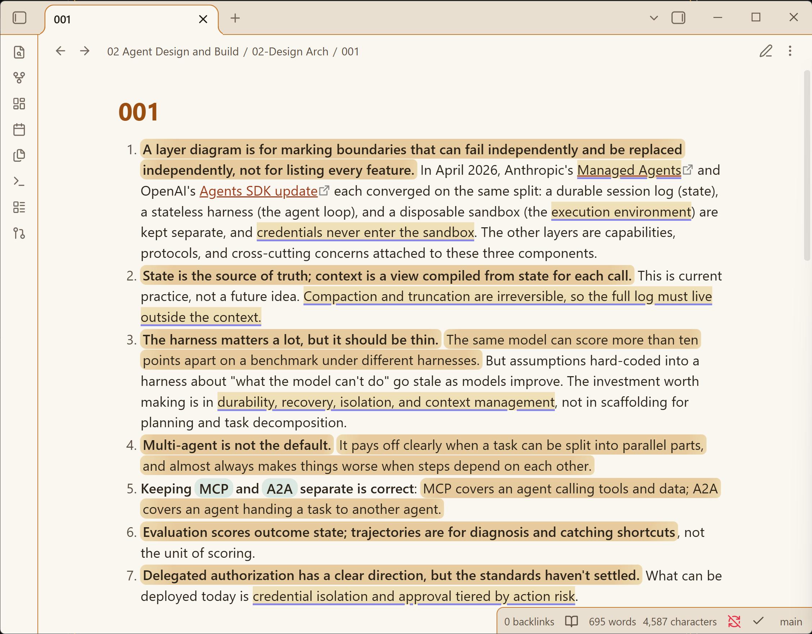

# Semantic Reading

Semantic Reading marks what matters inside your notes. A language model you configure reads each block and highlights key sentences, key terms, and named concepts directly in the text, in both reading view and live preview. Note files are never modified.

It is built for dense technical notes in Chinese and English, the kind you scan for what the author concluded, what supports it, and which concepts carry the argument.

<!-- Screenshot placeholder: drop your image at docs/probe-shots/screenshot.png and uncomment:

-->

## What gets highlighted

| Highlight | Meaning | Styling |
|---|---|---|
| Keypoint | The sentence that carries a block's point | Marker-pen gradient wash |
| Term | Domain keywords worth remembering | Solid indigo underline |
| Concept | Named models, methods, laws | Dotted teal underline, or a tinted pill |

Hover any highlight to see its role in a small chip. Each category can be turned off in settings. Colors adapt to your theme. The plugin measures background luminance and adjusts hue brightness and wash intensity, so light, dark, and custom themes stay readable. Text contrast stays above 7:1 on light themes and above 4.5:1 on dark ones, guarded by tests.

Two engines produce the highlights:

- **API engine.** Any OpenAI-compatible endpoint. The model returns verbatim quotes from each block; quotes that cannot be anchored back into the text are dropped, so a hallucinated highlight cannot render.

## Network use

Classification sends the text blocks of the note you open to the OpenAI-compatible endpoint you configure, and to nothing and no one else. This is the plugin's only network access. The API engine requires an account with your chosen provider, and some providers charge for usage. Results are stored in the plugin's own cache file inside `.obsidian/plugins/semantic-reading/`. Note content on disk is never modified. The offline heuristic works without an account.

## Install and configure

1. Install from the community directory, or copy `main.js`, `manifest.json`, and `styles.css` into `<vault>/.obsidian/plugins/semantic-reading/` and enable it in Settings → Community plugins.
2. Settings → Semantic Reading → Classification API. Fill in the base URL, API key, and model, then click **Test connection**.
3. Open a note. Heuristic highlights appear immediately, and API highlights follow within seconds.


| Provider | Base URL | Notes |
|---|---|---|
| Zhipu GLM Coding Plan | `https://open.bigmodel.cn/api/coding/paas/v4` | Use the coding endpoint; `/api/paas/v4` rejects plan keys. Keep "Disable model thinking" enabled; it cuts annotation time from minutes to seconds. |
| OpenAI | `https://api.openai.com/v1` | e.g. `gpt-4o-mini` |
| DeepSeek | `https://api.deepseek.com/v1` | e.g. `deepseek-chat` |
| Ollama (local) | `http://127.0.0.1:11434/v1` | Any non-empty key |

Commands: **Reclassify current note** forces a fresh API pass. **Diagnose rendering** writes `diagnosis.txt` into the plugin folder. The [Chinese user guide](docs/user-guide.zh.md) has a full walkthrough.

## Behavior details

- Annotations are cached per block, keyed by a hash of the block's normalized source text (5000-block LRU). Unchanged blocks are never re-annotated; an edit re-annotates only what changed.
- Quotes are anchored by significant-character matching, so a highlight survives bold markers, link syntax, and re-wrapping.
- Editing retriggers annotation after a 1.5s debounce. A failed API call keeps heuristic highlights and backs off for 60 seconds.
- Notes larger than 16,000 characters are annotated in block-boundary chunks.

## Development

```
bun install
bun test                                  # 48 tests: anchoring, parse, store, pipeline, mock-server e2e, palette
npm run build -- --production             # esbuild bundle to main.js
```

Design rationale, the two architecture candidates considered, and the palette measurements live in `docs/design.md`. Release steps live in `docs/publish/RELEASING.md`. MIT license, see `LICENSE`.
